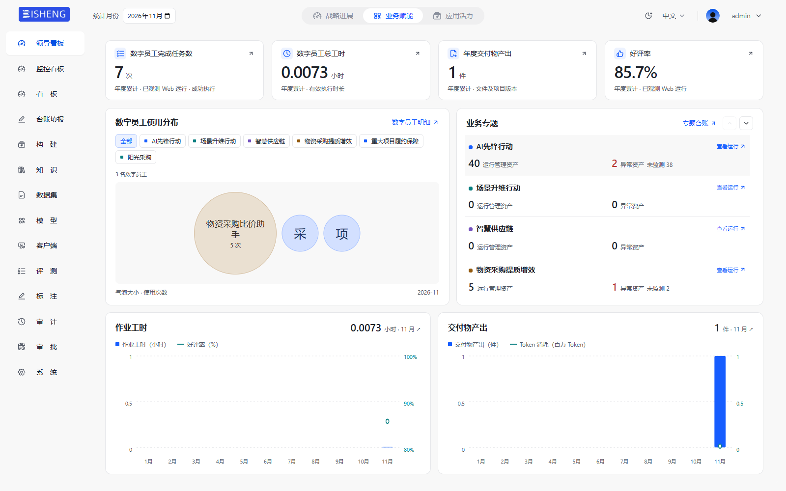

# 公司看板数据字典验收 · 2026 年 11 月 27 日

验收对象为本地 BiSheng 的领导看板和监控看板，统计月份为北京时间 2026 年 11 月。按[指标数据字典](../../../docs/observability/公司看板指标数据字典.xlsx)的 T01–T11 验收。11 组任务的核心统计结果均符合预期。普通对话出现过暂时性失败，问答库检索返回的题面也缺少答案，详见下文。234 条数据说明中的每种历史兼容、权限和缺数情形仍需结合相应样本复测。

## 本地看板在对话前后的变化

集中采购中心和财务共享中心各完成一轮采购助手对话，另外一轮在工具执行期间被取消。对话经过本地工作台和实际工具调用链，模型和供应商报价服务按约定返回可重复的响应。普通工作台对话单独验证。以下为追加这些请求前后的实测值。

| 页面指标 | 操作前 | 操作后 | 对账依据 |
| --- | ---: | ---: | --- |
| 数字员工运行（成功 / 失败 / 取消） | 5 / 1 / 0 | 7 / 1 / 1 | 两次任务形成成功终态，中止的任务单列 |
| 本月数字员工交互轮次 | 5 | 7 | 普通对话后为 5，两次正式助手回复后依次为 6、7，随后取消仍为 7 |
| 本月资产使用次数 | 15 | 22 | 数字员工 5→7、知识库 4→6、Skill 3→5、工具成功 3→4 |
| 工具失败次数 | 2 | 4 | 一次供应商拒绝、一次执行中止。供应商拒绝后助手仍完成了回复 |
| 场景本年使用 / 服务用户 | 4 次 / 3 人 | 6 次 / 3 人 | 两次成功均来自已服务用户 |
| 数字员工好评率 | 80.0% | 85.7% | 5→7 次成功均关联终态消息，最终负评仍为 1 次；新增两次未主动评分 |
| 主动作业时间 | 25.162 秒 | 26.150 秒 | 两次成功分别增加约 0.533、0.455 秒；取消未增加主动工时 |
| 监控成功 / 失败 | 12 / 3 | 17 / 5 | 仅统计当前受监控的员工、知识库和工具。11 月 27 日新增 5 成功、2 失败 |
| 年度交付物 | 1 件 | 1 件 | 本机此次新增对话没有登记文件。下表 T09 的四件成果属于隔离环境 |

对账覆盖 `board_runtime_event` 的只读分组、`overview`、`trends`、`monitoring` 和实际浏览器页面。操作后，21 条有回执的模型事件合计输入 11,306 Token、输出 2,846 Token，总计 14,152。监控范围为 47 项资产，其中已监测 6、未监测 41；已监测的 6 项中，正常和异常各 3 项。按资产下钻遍历当前目录全部 52 项，逐项比对首排指标、单资产分期汇总与期间趋势，包括无观测状态；此范围另含 Skill。

## 字典任务验收结果



| 任务 | 业务操作与预期 | 实际结果与验证层次 |
| --- | --- | --- |
| T01 年度目标与专题 | 设数字员工目标 10、场景目标 4，两个专题仅一个标星，两个场景仅一个投产。 | 隔离计划接口得到 1/4，星标列表仅一项。本机组织树和看板均为 48 个直属单位；战略页实显数字员工 3/100、场景 1/2，两项已标星专题可切换。 |
| T02 知识分类与接入 | 将同一库从计划 2 个的分类转到计划 4 个的分类。 | 隔离业务链读到旧分类 1/2→0/2、新分类 0/4→1/4，首次有效归类时已计入接入量。草稿未进公开目录，发布后换类，目录内仍只有该库。本机首页依次显示数字化 50%、法务 25%、市场 25%、财务 20%，下钻六类合计 4/20。 |
| T03 首次发布与部门 | 在同一直属单位的两个下属组分别首发一个助手、一个工作流，另一直属单位首发工具和公共 Skill，再将助手重新上架。 | 隔离产品发布事务产生两条数字员工首发，两件均归集中采购中心，重上架后仍是 2，运行数保持 0。本机集中采购中心“本月新增”有 5 项，逐类筛选与首发记录一致。 |
| T04 普通对话与数字员工 | 对照工作台普通对话和正式助手对话。 | 本机正式助手消息 62、74 各使成功任务和交互轮次增加 1；中止消息 76 未增加轮次。随后普通对话从历史消息 84 读回“已收到您的工作安排。”，运行数维持 9、交互轮次 7、场景使用 6 次。 |
| T05 Skill、知识库、MCP | 在正式助手里实际进入 Skill、检索知识库、调用 MCP，分别取得报价和供应商拒绝回执。 | 本机两轮均生成了实际 Skill 和知识回执。第一轮工具成功，四类有效使用共 +4；第二轮工具失败、员工成功，四类有效使用共 +3。随后取消的第三轮另留下一次工具失败。资产仅发布时运行数为零，见 T03。 |
| T06 场景软关联与用户去重 | 让两个均已投产的场景关联同一助手。甲用户成功三次，乙用户成功一次。 | 隔离正式对话处理器产生四条终态，战略返回 1次/1人、2次/1人、3次/1人、4次/2人。两场景均无法独占该次执行，业务赋能场景归因明细为空。本机对话前的另一个样本只有一个场景已投产，明细实显 3 次、0.0066 小时、66.7%。 |
| T07 改评与跨月处置 | 在 10 月 31 日 23:58 首次负评、23:59 改赞，11 月 1 日 00:00 处置并重复提交。 | 隔离的成功回复按实际评价接口得到 100%→0%→100%，改评后原负评仍是唯一待办。回看 10 月底待办 1，11 月新发 0，年度已办 1，重复提交保留首次措施。本机已处理列表亦能查看真实样本的原评价及处理措施。 |
| T08 工时、失败与取消 | 成功及失败任务的主动时间入账，纯工具等待和取消不入账。 | 本机真实取消保留中止回复，员工终态为 cancelled，主动秒数为空。隔离工具执行约 0.489 秒后模型报错，失败数 +1、成功数不变，此次只增加约 0.009 秒主动工时。并行工具与模型的受控时钟用例中，60 秒总历时计入 40 秒。 |
| T09 文件与项目版本 | 独立交付三个文件，再将两个代码文件登记为同一项目版本并重放；另试仅回复代码文本。 | 隔离正式助手处理器、代码解释器及临时对象存储实际生成并读回文件，先得到 3 文件/0 版本/3 件。两份代码文件登记后为 3 文件/1 版本/4 件，两条成员关系共用同一版本；重放及仅回复代码文本均维持 4 件。本机共享样本仍为 1 件。 |
| T10 科研经营累计值 | 两个月分别直报累计项目 5、8，保留同一课题，再修订 9 月工作量及价值。 | 隔离接口回看 9 月为修订 2、5 项，10 月为修订 1、8 项；11 月继承 10 月的 8 项。历史人天及价值分别为 4/0.32 万元、5/0.4 万元。本机月报页面实显 3 个项目、2 个 AI 项目、1 个在研 AI 项目。 |
| T11 历史目录、Token 与气泡 | 分别检查零运行的上线资产、缺回执的月份，以及不同专题最大用量下的圆直径。 | T03 的两件新员工资产上线且未运行。本机 10 月完整目录和 Token 显示“—”，历史目录下钻首发可核实子集为 0 项。模型回调分别收到 600+400、空回执、只有输入 900，最终仅登记 1,000 Token。首轮两个专题峰值分别为 3、1 次，最大直径均为 168 像素；追加对话后峰值 5、1 次，最大直径仍是 168 像素。 |

## 运行中发现的问题

- **普通对话暂时没有生成有效回复。** 本机两次请求被配额保护以 `projection_backpressure` 拒绝，历史记录没有可用答复。之后使用同一用户和本地模型重试，正常回复可从历史读回。未改动配额配置。现有证据能定位到当次拒绝，无法推断持续时长或影响的用户范围。
- **知识库检索成功，但本次回执缺少答案。** 两轮采购助手均计入成功检索，回执包含匹配题面，未包含问答库中保存的答案。这个成功数能证明检索执行完成；回答质量仍需用返回文本和原始知识条目另行验收。[问答检索复验](acceptance/live-qa-retrieval.py)

## 复核入口

[实际看板对账](acceptance/live-boards.cjs)用于核对四页总览、部门选项、首发与下钻。[字典页面验收](acceptance/dictionary-views.cjs)用于核对气泡、监控汇总和分组、历史缺数及全目录单资产卡片。两者都读取本机 3001 端口；把 `BOARD_SESSION` 指向仓库外的本地登录状态文件，在仓库根目录运行。字典脚本默认使用 2026 年 11 月样本，需当期至少两个专题的峰值不同、前一月没有 Token 回执。

```powershell
$checks = 'features/v3.0.2/122-company-boards/acceptance'
node "$checks/live-boards.cjs"
node "$checks/dictionary-views.cjs"
node "$checks/drilldown.cjs"
```

第三个命令使用前端模拟接口，覆盖监控的翻页、反馈搜索、草稿恢复、处置及执行明细权限。另在当前本机后端容器运行 `/app/.venv/bin/python -m unittest discover -s /app/test/company_board -p 'test_*.py'`，72 个公司看板测试全部通过。加载本次新增的模型回执用例后，在同版隔离容器再跑，73 个测试全部通过。[模型回执测试](../../../src/backend/test/company_board/test_runtime_observation.py)隔离测试临时提供模型响应、身份或时钟，按案例保留生产业务代码、消息和事件持久化、汇总查询；运行范围详见各任务。

需要重放写入时，使用[建设计划、首发与科研月报](acceptance/planning-report-scenarios.py)、[场景归因、改评与跨月处置](acceptance/scene-feedback-observer.py)和[真实文件交付与失败工时](acceptance/delivery-observer.py)。前两组使用临时 SQLite。交付实验使用独立对象存储，脚本开头提供了从仓库根目录启动、验证和清理测试容器的 PowerShell 命令。三组都不依赖本机共享看板的累计值。共享本地环境的对话测试每次会新增消息，复跑时用操作前后差值验收。[工作台与助手对话回放](acceptance/live-chat.md)
