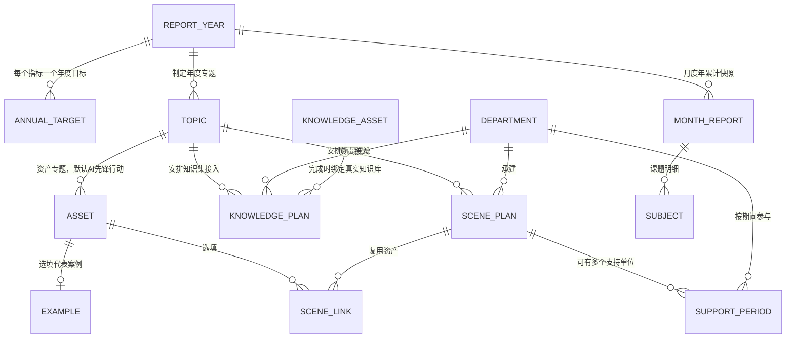

# 看板填报与数据关系

管理员从毕昇左栏「台账填报」选择年度。同一公司、同一年度有三种填报入口。系统管理员和获授权的数科部管理员维护计划、完成事实与科研经营数据。资产的业务信息由拥有该资产编辑权的人在创建或编辑时维护。

| 入口 | 一次业务操作 | 看板读数 |
|---|---|---|
| 年度建设计划 | 设置年度数字员工和投产场景目标，按专题新增场景，指定承建和支持单位，投产后补实际日期 | 年度目标、场景投产进度、专题清单、场景责任与认定。数字员工建成数来自资产上线 |
| 知识接入计划 | 在同一年度和专题下登记业务知识集，明确分类和承建单位，完成时绑定实际知识库并填写检索核验日期 | 各分类计划数、已接入数和明细 |
| 科研与经营 | 选择报告月份，一次保存年累计指标与课题子表 | 科研及 AI 项目数和占比、在研预算、经费、合同待收余额、预计价值和等效人工工作量 |

## 计划、责任与完成

| 对象 | 从属与填写内容 | 完成或统计规则 |
|---|---|---|
| 年度目标 | 属于公司年度。数字员工目标单位为位，投产场景目标单位为个 | 分别作为建设进度的分母。年度目标可早于专题分解确定 |
| 专题 | 属于年度，一个专题可有多个场景计划和多个知识接入条目 | 专题通过子项和关联资产汇总。场景与知识集是并列的建设对象 |
| 场景计划 | 属于一个专题，有一个承建单位。计划日期、实际投产日期均保存在该场景上 | 计划日期用于排期，达到实际投产日期才计入已投产。同一场景对全公司只计一次 |
| 支持单位 | 一个场景可有零到多个支持单位。每条关系含部门、参与起日和可选结束日 | 承建单位不可再列为支持单位。同一支持部门的期间不能重叠。按部门可回查参与的场景 |
| 高价值场景 | 场景内可登记高价值认定的生效和结束日期 | 截至日有效认定按场景去重。近 90 天实际使用榜从运行事实另行计算 |
| 知识接入条目 | 属于同年度的一个专题，有业务分类、承建单位、计划日期。接入后补知识库及检索核验日期 | 每条计划知识集贡献一个分母。关联真实知识库，且核验日不晚于统计截止日，才贡献一个分子。创建知识库本身不会完成计划 |
| 数字员工上线 | 助手、工作流、托管应用按真实资源键识别，成功上线后记录首发日期与可核实的部门 | 公司建成数按资源去重。变更版本、复用到第二个场景或重复上线不新增员工。历史资产在现有目录中可见，历史上线日期以可核实的记录为准 |

**例。** 年度场景目标为 7 个。「供应链智能化」专题下只有一个「采购报价比对」场景，由采购部门承建，财务和法务支持。计划 5 月完成，实际 6 月投产。查 5 月时该计划可见，完成数为 0；查 6 月时为 1，目标仍是 7。同专题的「采购制度集」在 5 月登记，6 月绑定知识库并核验，显示由 0/1 变为 1/1。即使两个支持单位都参与，系统仍只计算一个场景和一个知识集。

## 资产归属、关联与案例

文档知识库和 QA 知识库在创建或编辑时，可展开「看板归属（选填）」选择所属专题及关联场景。

助手和工作流在创建或编辑时展开「看板归属与代表案例」。Skill、自建 API 工具和 MCP 工具也可在各自的管理入口填写，托管应用从详情的「发布」设置进入。

创建人可以直接使用默认专题「AI先锋行动」，也可以选择其他专题并关联其下的一个或多个场景。关联场景为选填。支持代表案例的资产可补业务方向、业务说明，Skill 还可补规则说明，供看板的资产明细展示。案例内容可包括名称、简介、输入、输出及成果样表。案例随资产归入专题；资产上线进入公司目录后，看板可按专题或场景找到它。配置业务关系本身不增加资产调用次数。

同一项资产被多个场景复用时，专题资产数按资源键去重，实际使用按执行记录和当日有效关联归集。执行不能唯一确定场景时仍进入公司总量。原台账中的关联和案例供历史回查，后续维护从资产编辑入口进入。

## 科研与经营

一个公司年度可有多个月份快照。每张快照保存一组截至该月的累计值，以及当期课题列表。每个课题保留稳定编号、名称、所属项目、AI 标记、开始日期及可选结题日期。单次保存同时更新指标与子表，并校验版本，防止覆盖其他人的修改。

- **科研规模**直接填科研项目总数、AI 项目数、在研 AI 项目数和在研 AI 项目预算。AI 项目占比由 AI 项目数除以科研项目总数计算，AI 课题占比从课题子表计算。
- **经费与合同**直接填年度 AI 项目经费净支出、截至该月的合同待收余额，金额以万元计。填报人无需登记单笔款项。
- **价值指标**直接填已估值场景数、节约人工价值、其他直接经济收益、等效人工工作量（人天）及等效工作量价值（万元）。预估年度产值由节约人工价值与其他直接收益相加；数字员工实际工时仍从执行记录计算。
- **回看历史**时读取该年度不晚于所选月的最近快照。显式的 0 表示已填为零，空值表示尚未填报。第一次直接填报以前，已有旧记录可提供可核实的历史口径。新快照与旧流水不会重复相加。

例如，5 月报合同待收 18.5 万元，6 月报 12 万元，分别回看两个月会看到各自余额。每个月报告的是当时余额，全年累计时不把 18.5 和 12 相加。

## 存储与取数

沿用本租户原有的 `company_board_ledger` 和 `board_supplement`。目标、专题、场景、知识计划和已观察到的首次上线沿用稳定记录键；计划日期、多个支持单位、知识分类、资产归属、经营快照和课题保留各自的从属键及修订号。三个页面按业务对象组合读写，无需管理员为每个子记录切换页面。用户和部门取自系统组织，资产取自真实资源目录，实际执行、文件产出和工具调用继续取运行事实。

[年度计划与知识接入浏览器验收](acceptance/annual-planning.cjs) · [科研经营跨月验收](acceptance/research.cjs) · [资产入口验收](acceptance/asset-entry.cjs)
